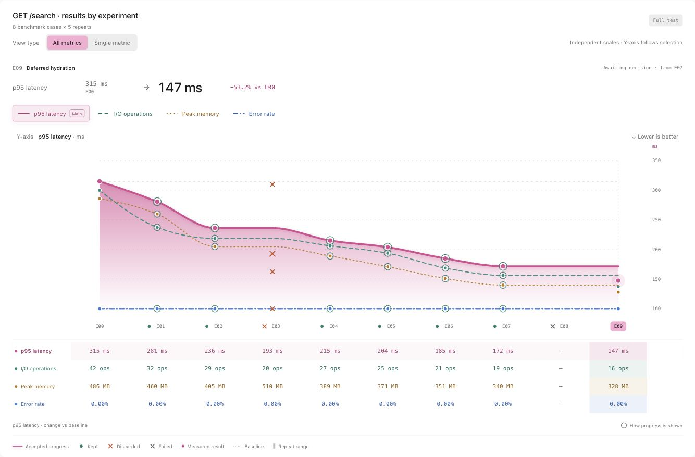
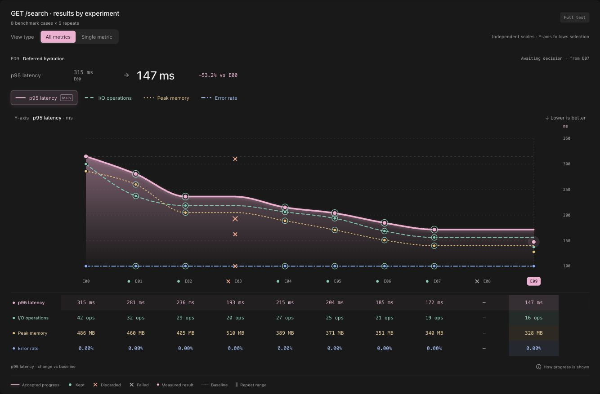
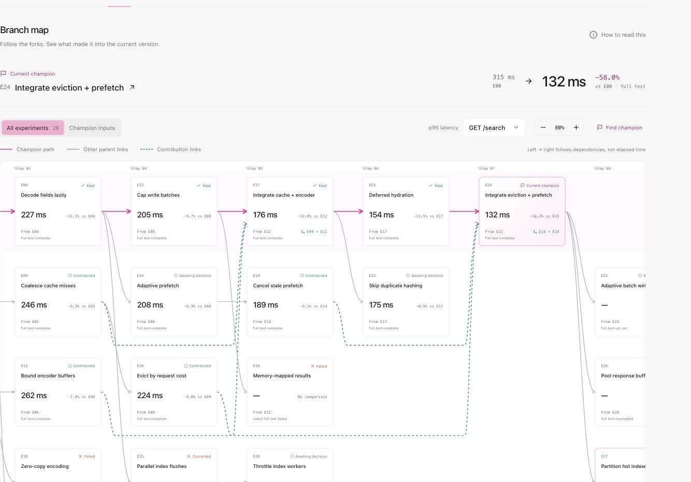
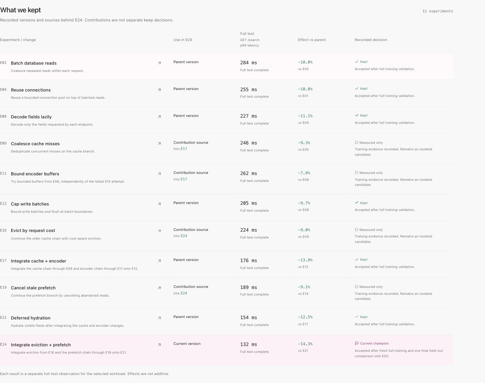
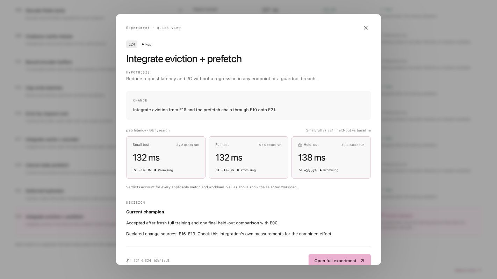

# bench

Run isolated experiments. Measure what changed. See what was worth keeping.

`bench` is an agent skill for optimizing application performance, LLM systems, and other agent skills. It helps define the benchmark, choose representative cases, test changes in separate Git worktrees, and explain the results in an interactive viewer.

## Install

```sh
npx skills add galElmalah/skills --skill bench
```

For a global Codex installation:

```sh
npx skills add galElmalah/skills --skill bench --agent codex --global
```

The CLI, playbooks, schema, examples, and **prebuilt viewer** are included in the skill. Running them requires Python 3.10+ and Git on macOS/Linux; no npm or pip setup is needed after installation. The Skills installer requires Node.js 22.20+.

## Watch the metrics



*Screenshots use the bundled synthetic example studies. The displayed improvements illustrate the UI, not results promised for your application.*

Choose one **main metric** and keep secondary objectives and guardrails visible. Each workload retains its own results. The graph can show all applicable metrics or one at a time; selecting a metric puts its native units on the Y-axis. Overlaid metrics use independent scales.

Values stay in aligned rows below the graph. Hover or focus an experiment to inspect its result and effect without moving labels around. Kept, discarded, failed, and undecided attempts remain distinguishable.

<details>
<summary>See the dark theme</summary>



</details>

## Follow the branches and see what stayed



Each experiment starts from a recorded parent snapshot. The pink path follows the current champion's parents; teal links identify explicit contribution sources. Combining independent ideas creates a new experiment whose combined behavior must be measured.

The **What we kept** table lists parent versions and explicit contribution sources, with the change, full-test result, effect versus parent, and recorded decision. A contributed source is not automatically a separately accepted experiment.

<details>
<summary>See the kept-changes table</summary>



</details>

## Open the evidence behind an experiment



Click a graph point, branch card, or table entry for a quick view of the change and its small, full, and held-out results. Open the full experiment record for run history, commands, snapshots, events, logs, artifacts, and results across metrics and workloads.

## Ask your agent to use it

```text
Use $bench to reduce search latency and storage reads without changing results.
Define representative small and full training suites, reserve held-out cases,
try isolated changes, and show what each experiment changed and why it was kept.
```

The workflow:

1. Define the main metric, secondary objectives, correctness checks, guardrails, and stopping rule.
2. Freeze a small training suite, a broader full training suite, and separate held-out cases.
3. Measure the unchanged baseline, then create each experiment from a recorded parent in its own worktree.
4. Screen changes quickly and validate promising candidates on the full suite.
5. Record the evidence and decision. Remeasure combinations of independent changes.
6. Check the selected result on held-out cases before claiming it generalizes.

Independent implementation can run in parallel. The bundled runner serializes local measurements to reduce contention; separate worktrees do not isolate CPU, databases, ports, or API limits. Promotion advances the study's champion reference, not the application's main branch.

## Try a real measured example

Set `BENCH_SKILL` to the installed directory containing `SKILL.md`. The example creates a small repository, measures file lookups, and tests a cache in an isolated worktree.

```sh
BENCH_SKILL=/absolute/path/to/installed/bench
python3 "$BENCH_SKILL/examples/create_demo.py" --output /tmp/bench-example
python3 "$BENCH_SKILL/scripts/bench.py" serve --study /tmp/bench-example/study --port 4318
```

Open the localhost URL printed by the server. These are real measurements of a deliberately small fixture; the example runs the small and full suites and leaves held-out cases untouched. Keep studies and target code outside the installed skill directory.

For an existing harness, use the [CLI and adapter reference](references/toolkit.md) to collect or import measurements into the portable report format.

## What's included

```text
bench/
  SKILL.md                 Agent workflow and playbook routing
  README.md                This guide
  agents/openai.yaml       Skill presentation
  scripts/                 Python CLI, validation, context, and read-only MCP server
  schema/                  Versioned JSON report contract
  examples/                Runnable study and adapter fixtures
  references/              Domain playbooks and toolkit instructions
  assets/viewer/           Prebuilt browser viewer and native UI resource
  assets/screenshots/      Documentation previews
```

The browser viewer works with a normal skills installation. Native Codex panes and chat widgets additionally require the optional plugin's MCP registration; installing the skill alone does not register it. See [Native UI](references/native-ui.md) for supported surfaces and capability checks.

## Playbooks

| Task | Guide |
| --- | --- |
| Design a study, split cases, and plan parallelism | [Experiment design](references/experiment-design.md) |
| Prepare harnesses, fixtures, and OpenTelemetry | [Prepare the codebase](references/prepare-codebase.md) |
| Optimize endpoints, CPU, memory, latency, or I/O | [System performance](references/system-performance.md) |
| Evaluate prompts, models, retrieval, quality, and cost | [LLM evaluations](references/llm-evals.md) |
| Improve a reusable skill or agent procedure | [Skill evaluations](references/skill-evals.md) |
| Choose the next experiment or resume a study | [Iteration strategy](references/iteration-strategy.md) |
| Run commands and integrate a measurement adapter | [Toolkit interface](references/toolkit.md) |

Read [SKILL.md](SKILL.md) for the agent instructions or inspect the [report schema](schema/benchmark.schema.json) to integrate another measurement tool.

Chart geometry is adapted from [Mebius charts](https://www.mebius.design/freebies/charts). Its [license and attribution](assets/viewer/licenses/mebius/SOURCE.md) ship with the viewer.
